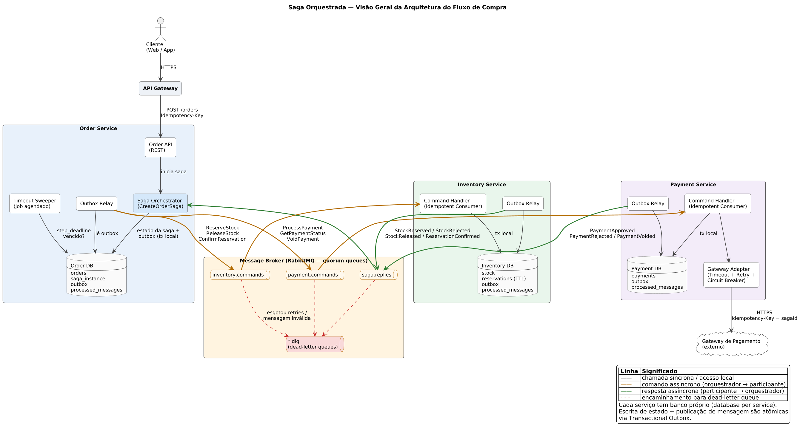
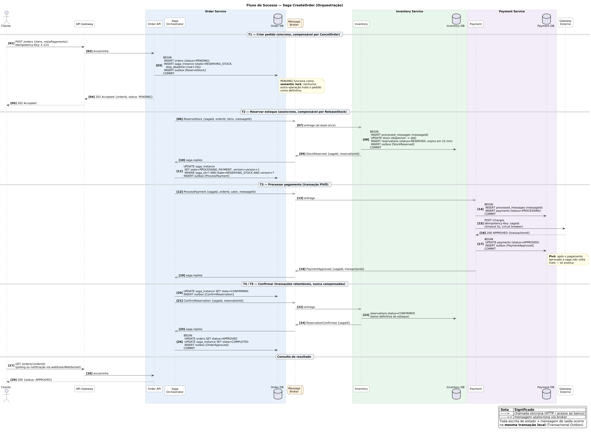
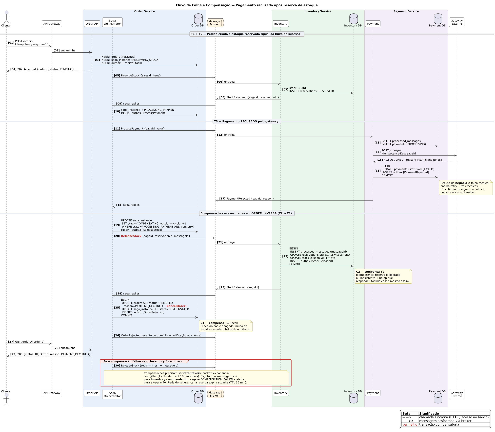
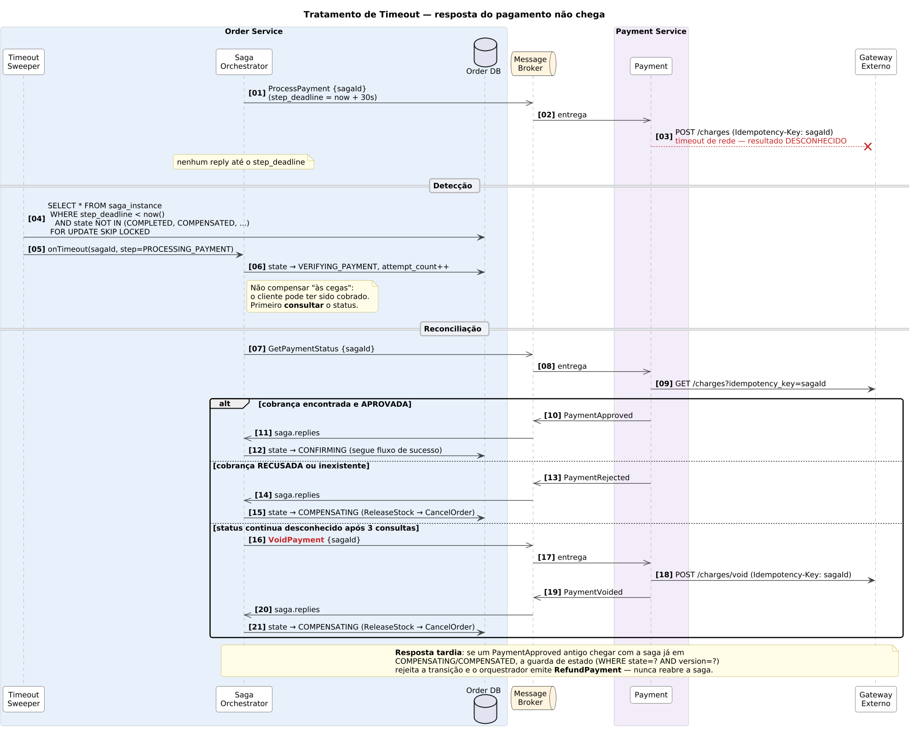
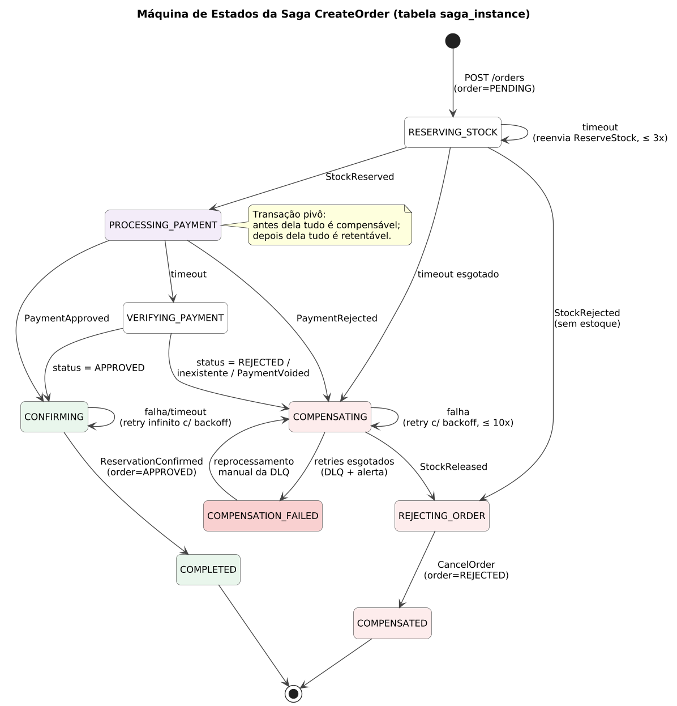

# Saga Pattern — Blueprint de Arquitetura do Fluxo de Compra

> **APS 09 — Cloud Design Patterns** · Desenho e Modelagem do Padrão Saga em um Projeto Real
> Autor: João Pedro

Blueprint arquitetural para a transação distribuída de **criação de pedido** em um e-commerce migrado de monólito para microsserviços. O foco é o comportamento do sistema no caminho feliz **e** no caminho de falha (compensação), com consistência eventual, idempotência e resiliência a falhas de rede.

---

## Sumário

1. [Contexto de negócio](#1-contexto-de-negócio)
2. [Decisão: Orquestração vs. Coreografia](#2-decisão-orquestração-vs-coreografia)
3. [Visão geral da arquitetura](#3-visão-geral-da-arquitetura)
4. [Transações da saga e compensações](#4-transações-da-saga-e-compensações)
5. [Diagrama de sequência — sucesso](#5-diagrama-de-sequência--sucesso)
6. [Diagrama de sequência — falha e compensação](#6-diagrama-de-sequência--falha-e-compensação)
7. [Máquina de estados e controle de timeouts](#7-máquina-de-estados-e-controle-de-timeouts)
8. [Matriz de decisão e idempotência](#8-matriz-de-decisão-e-idempotência)
9. [Estrutura do repositório](#9-estrutura-do-repositório)
10. [Referências](#10-referências)

---

## 1. Contexto de negócio

A empresa está quebrando o monólito de e-commerce em microsserviços. O fluxo de compra — o mais crítico em receita — passa a atravessar três domínios, cada um com **banco de dados próprio** (*database per service*):

| Serviço | Responsabilidade | Dados que possui |
|---|---|---|
| **Order Service** | Registrar o pedido e gerenciar seu ciclo de vida. Hospeda o orquestrador da saga. | `orders`, `saga_instance` |
| **Inventory Service** | Controlar estoque e fazer reservas temporárias. | `stock`, `reservations` |
| **Payment Service** | Processar o pagamento junto ao gateway financeiro externo. | `payments` |

No monólito, "criar pedido + baixar estoque + cobrar" era uma única transação ACID. Com bancos separados isso deixa de existir: 2PC/XA não é viável (gateways externos não participam, bloqueio distribuído derruba disponibilidade e acopla os serviços). A solução é uma **Saga**: uma sequência de transações locais, em que cada passo publica a mensagem que dispara o próximo e, se um passo falhar, **transações compensatórias** desfazem semanticamente os passos anteriores.

**Requisitos de negócio que guiam o desenho**

- Um cliente **nunca** pode ser cobrado sem ter o pedido aprovado (ou reembolsado).
- Estoque reservado para um pedido que falhou **deve** voltar a ficar disponível.
- O pedido aceito pela API não pode "sumir": todo pedido termina em `APPROVED` ou `REJECTED`, com motivo.
- Picos de tráfego (Black Friday) não podem derrubar a criação de pedidos por lentidão do gateway de pagamento.

---

## 2. Decisão: Orquestração vs. Coreografia

**Decisão: Saga orquestrada**, com o orquestrador `CreateOrderSaga` vivendo dentro do Order Service, comunicação por comando/resposta assíncronos via RabbitMQ e estado persistido na tabela `saga_instance`.

### Matriz de decisão

Notas de 1 (pior) a 5 (melhor) para **este** fluxo.

| Atributo de qualidade | Peso | Coreografia | Orquestração | Comentário |
|---|:---:|:---:|:---:|---|
| **Acoplamento** entre serviços | 3 | 3 | 4 | Na coreografia cada serviço precisa conhecer e reagir aos eventos dos outros (Payment escuta `StockReserved`, Inventory escuta `PaymentRejected`…). Na orquestração os participantes só conhecem os **próprios** comandos; o acoplamento fica concentrado e explícito no orquestrador. |
| **Complexidade** de entender e manter o fluxo | 3 | 2 | 5 | Com coreografia a lógica da saga fica espalhada em N serviços — ninguém "vê" o fluxo inteiro. A orquestração tem uma máquina de estados única, legível e testável. |
| **Tratamento de falhas / compensação** | 3 | 2 | 5 | Timeouts, reconciliação do pagamento ambíguo e ordem inversa das compensações exigem um lugar que **saiba onde a saga está**. Na coreografia isso vira estado implícito distribuído. |
| **Observabilidade / auditoria** | 2 | 2 | 5 | `saga_instance` responde "em que passo está o pedido X?" com uma query. Exigência de auditoria financeira. |
| **Escalabilidade** | 2 | 5 | 4 | Coreografia não tem componente central. O orquestrador, porém, é *stateless* (estado no banco), escala horizontalmente e a carga por saga é baixa (poucas mensagens). |
| **Ponto único de falha** | 1 | 5 | 3 | Mitigado: múltiplas réplicas do orquestrador, estado persistido, retomada após crash. |
| **Evolução do fluxo** (novos passos, ex.: antifraude, frete) | 2 | 2 | 5 | Adicionar um passo = um estado novo no orquestrador. Na coreografia é preciso reescrever quem escuta o quê, com risco de dependências cíclicas. |
| **Total ponderado** | | **44** | **73** | |

### Justificativa

- **Acoplamento**: a coreografia parece mais desacoplada, mas cria acoplamento *implícito* por eventos — o Payment passa a depender do formato de `StockReserved`, o Inventory do de `PaymentRejected`, e assim por diante. Com orquestração, Inventory e Payment são **participantes passivos** que expõem uma API de comandos (`ReserveStock`, `ReleaseStock`, `ProcessPayment`…) e não sabem que existe uma saga.
- **Complexidade**: são três serviços, mas o fluxo de falha tem ramificações não triviais (recusa vs. timeout vs. resposta tardia). Isso é exatamente o caso em que uma máquina de estados central compensa o custo de ter um componente a mais.
- **Escalabilidade**: o gargalo real é o gateway externo, não o orquestrador. O orquestrador não guarda estado em memória; qualquer réplica processa qualquer resposta, então escala com o número de consumidores na fila `saga.replies`.
- **Quando eu escolheria coreografia**: fluxos curtos (2 passos), sem ramificações de falha, ou notificações *fire-and-forget* — por isso o evento final `OrderApproved`/`OrderRejected` é publicado como evento de domínio para quem quiser ouvir (notificação, analytics), sem fazer parte da saga.

O registro completo da decisão, com alternativas descartadas, está em [`docs/decisoes-arquiteturais.md`](docs/decisoes-arquiteturais.md#adr-001--saga-orquestrada).

---

## 3. Visão geral da arquitetura



**Como ler o diagrama**

- O cliente chama `POST /orders` (síncrono) e recebe **`202 Accepted`** com o `orderId` em estado `PENDING`. O resultado final é obtido por *polling* (`GET /orders/{id}`) ou notificação — o cliente nunca fica pendurado esperando o gateway de pagamento.
- O **Saga Orchestrator** envia comandos para filas de cada participante (`inventory.commands`, `payment.commands`) e recebe todas as respostas numa única fila (`saga.replies`).
- Cada serviço publica mensagens via **Transactional Outbox**: a mudança de estado e a mensagem de saída são gravadas na mesma transação local, e um *Outbox Relay* as publica no broker. Isso elimina o problema de "gravou no banco mas não publicou" (ou vice-versa).
- Cada consumidor é um **Idempotent Consumer** com tabela `processed_messages`.
- O **Timeout Sweeper** varre sagas com `step_deadline` vencido e as faz avançar (retry, reconciliação ou compensação).
- Mensagens que esgotam as tentativas vão para **dead-letter queues** (`*.dlq`).
- O **Gateway Adapter** isola a chamada externa com timeout, retry e circuit breaker.

---

## 4. Transações da saga e compensações

Seguindo a classificação de Chris Richardson (microservices.io), cada passo é **compensável**, **pivô** ou **retentável**:

| # | Transação | Serviço | Tipo | Compensação | Observação |
|---|---|---|---|---|---|
| T1 | `CreateOrder` (pedido `PENDING`) | Order | Compensável | **C1 — `CancelOrder`** → `REJECTED` | `PENDING` funciona como *semantic lock* |
| T2 | `ReserveStock` | Inventory | Compensável | **C2 — `ReleaseStock`** | Reserva tem TTL de 15 min como rede de segurança |
| T3 | `ProcessPayment` | Payment | **Pivô** | — | Ponto de não retorno: aprovado ⇒ a saga só avança |
| T4 | `ConfirmReservation` | Inventory | Retentável | — | Baixa definitiva do estoque. Retry até concluir |
| T5 | `ApproveOrder` | Order | Retentável | — | Transação local do orquestrador |

**Regras derivadas**

- Compensações rodam em **ordem inversa**: C2 (`ReleaseStock`) antes de C1 (`CancelOrder`).
- Compensações **não apagam** dados: mudam estado e preservam a trilha de auditoria.
- Toda compensação é **idempotente e retentável** — ela *precisa* terminar. Se não terminar, a saga vai para `COMPENSATION_FAILED` com alerta (ver [docs](docs/decisoes-arquiteturais.md#4-dead-letter-queues)).
- Passos depois do pivô **nunca** são compensados; falhas neles geram retry indefinido com backoff.

---

## 5. Diagrama de sequência — sucesso



| Passos | O que acontece | Síncrono / Assíncrono |
|---|---|---|
| 01–05 | Cliente envia `POST /orders` com `Idempotency-Key`. O Order Service grava, **numa única transação**, o pedido `PENDING`, a `saga_instance` e o comando `ReserveStock` no outbox. Responde `202 Accepted`. | Síncrono (HTTP) |
| 06–11 | `ReserveStock` vai pela fila; o Inventory registra a mensagem em `processed_messages`, cria a reserva e devolve `StockReserved`. O orquestrador avança a saga com *optimistic locking* (`WHERE state=? AND version=?`). | Assíncrono |
| 12–19 | `ProcessPayment` → o Payment chama o gateway externo usando `sagaId` como chave de idempotência, com timeout e circuit breaker. Aprovado ⇒ `PaymentApproved`. **Pivô atingido.** | Assíncrono + HTTP externo |
| 20–26 | `ConfirmReservation` efetiva a baixa de estoque; o orquestrador aprova o pedido e marca a saga `COMPLETED`, publicando `OrderApproved`. | Assíncrono |
| 27–29 | Cliente consulta e recebe `APPROVED`. | Síncrono |

---

## 6. Diagrama de sequência — falha e compensação

Cenário pedido pela atividade: **o Payment recusa o pagamento depois que o Inventory já reservou o produto.**



| Passos | O que acontece |
|---|---|
| 01–10 | Igual ao fluxo de sucesso: pedido `PENDING`, estoque reservado. |
| 11–18 | O gateway responde **`402 DECLINED`**. O Payment grava `REJECTED` e publica `PaymentRejected`. Recusa de negócio **não** é retentada (só falhas técnicas são). |
| 19 | O orquestrador muda a saga para `COMPENSATING` (com guarda de estado/versão) e grava `ReleaseStock` no outbox. |
| 20–24 | **C2 — `ReleaseStock`**: o Inventory devolve a quantidade ao estoque e marca a reserva como `RELEASED`. Idempotente: liberar algo já liberado (ou nunca reservado) é *no-op* que ainda responde `StockReleased`. |
| 25–26 | **C1 — `CancelOrder`**: transação local no Order Service — pedido vai para `REJECTED` com motivo `PAYMENT_DECLINED`, saga para `COMPENSATED`, evento `OrderRejected` publicado para notificar o cliente. |
| 27–29 | Cliente consulta e recebe `REJECTED` com o motivo. |
| 30 | **Falha na compensação**: `ReleaseStock` é retentado com o **mesmo `messageId`**, backoff exponencial com jitter; esgotado ⇒ DLQ + `COMPENSATION_FAILED` + alerta. O TTL da reserva libera o estoque mesmo que tudo mais falhe. |

### Diagrama complementar — timeout no pagamento

O caso mais perigoso não é a recusa, é a **ambiguidade**: a chamada ao gateway estourou o tempo e não sabemos se o cliente foi cobrado. Compensar às cegas pode gerar "cobrou e cancelou o pedido".



O orquestrador entra em `VERIFYING_PAYMENT`, consulta o status no gateway pela chave de idempotência e só então decide: seguir (aprovado), compensar (recusado/inexistente) ou anular a cobrança com `VoidPayment` antes de compensar (status desconhecido após N tentativas). Respostas tardias de uma saga já compensada geram `RefundPayment`, nunca reabrem a saga.

---

## 7. Máquina de estados e controle de timeouts



### Tabela de controle de estado da saga

```sql
CREATE TABLE saga_instance (
    saga_id          UUID PRIMARY KEY,
    saga_type        VARCHAR(50)  NOT NULL,            -- 'CreateOrderSaga'
    order_id         UUID         NOT NULL UNIQUE,
    state            VARCHAR(30)  NOT NULL,            -- ver máquina de estados
    payload          JSONB        NOT NULL,            -- itens, valor, reservationId, transactionId...
    current_step     VARCHAR(30)  NOT NULL,
    step_deadline    TIMESTAMPTZ,                      -- quando o passo atual expira
    attempt_count    SMALLINT     NOT NULL DEFAULT 0,  -- tentativas no passo atual
    last_error       TEXT,
    version          INTEGER      NOT NULL DEFAULT 0,  -- optimistic locking
    created_at       TIMESTAMPTZ  NOT NULL DEFAULT now(),
    updated_at       TIMESTAMPTZ  NOT NULL DEFAULT now()
);

-- Índice parcial: o sweeper só olha sagas vivas
CREATE INDEX ix_saga_pending_deadline
    ON saga_instance (step_deadline)
    WHERE state NOT IN ('COMPLETED', 'COMPENSATED', 'COMPENSATION_FAILED');
```

### Como a tabela lida com timeouts de rede

1. **Todo comando enviado define um prazo**: ao gravar o comando no outbox, o orquestrador grava também `step_deadline = now() + timeout_do_passo` e zera `attempt_count`.
2. **Timeout Sweeper** (job a cada 5 s, em todas as réplicas) seleciona sagas vencidas com `FOR UPDATE SKIP LOCKED` — várias réplicas rodam em paralelo sem processar a mesma saga duas vezes.
3. **Ação por tipo de passo**:

| Estado vencido | Timeout | Ação | Limite | Depois do limite |
|---|---|---|---|---|
| `RESERVING_STOCK` | 10 s | Reenvia `ReserveStock` (mesmo `messageId`) | 3 tentativas | `COMPENSATING` (envia `ReleaseStock` por precaução — é idempotente) |
| `PROCESSING_PAYMENT` | 30 s | Vai para `VERIFYING_PAYMENT` e envia `GetPaymentStatus` | — | — |
| `VERIFYING_PAYMENT` | 15 s | Reenvia `GetPaymentStatus` | 3 tentativas | `VoidPayment` → `COMPENSATING` |
| `CONFIRMING` | 10 s | Reenvia `ConfirmReservation` | Ilimitado (backoff até 5 min) | Alerta após 1 h, sem compensar |
| `COMPENSATING` | 10 s | Reenvia `ReleaseStock` | 10 tentativas | `COMPENSATION_FAILED` + DLQ + alerta |

4. **Respostas atrasadas**: toda transição usa `UPDATE ... WHERE saga_id=? AND state=<estado esperado> AND version=?`. Se zero linhas forem afetadas, a resposta é obsoleta: é registrada em log e descartada (ou, no caso de `PaymentApproved` para saga compensada, dispara `RefundPayment`).

---

## 8. Matriz de decisão e idempotência

### Mecanismos de idempotência por camada

| Camada | Mecanismo | Como funciona |
|---|---|---|
| **Cliente → API** | `Idempotency-Key` + `UNIQUE (idempotency_key)` em `orders` | Clique duplo / retry do app devolve o **mesmo** `orderId` e não cria segunda saga. |
| **Mensagens** | Envelope com `messageId` (UUID), `sagaId`, `step`, `correlationId` | `messageId` é gerado uma vez no outbox; reenvios reutilizam o mesmo valor. |
| **Consumidores** (*Idempotent Consumer*) | Tabela `processed_messages (consumer, message_id) PK` gravada **na mesma transação** da mudança de negócio | Duplicata ⇒ `INSERT` viola PK ⇒ não reprocessa, **republica a resposta armazenada** (para o orquestrador não ficar esperando). |
| **Regras de negócio** | Chaves naturais únicas: `reservations(saga_id)`, `payments(saga_id)` | Mesmo se a deduplicação por mensagem falhar, não existem duas reservas/cobranças para a mesma saga. |
| **Gateway externo** | `Idempotency-Key: sagaId` na chamada HTTP | Retry após timeout não gera segunda cobrança. |
| **Orquestrador** | Guarda de estado + `version` (optimistic locking) | Resposta duplicada ou fora de ordem não faz a saga "andar duas vezes". |
| **Compensações** | Semântica *no-op* + *tombstone* | `ReleaseStock` de reserva inexistente grava um registro `CANCELLED` para o `sagaId`; se o `ReserveStock` original chegar **depois** (reordenação), ele é recusado. |

### Matriz de cenários de falha

| # | Cenário | Detecção | Ação do sistema | Garantia resultante |
|---|---|---|---|---|
| 1 | Mensagem entregue duas vezes (at-least-once) | PK em `processed_messages` | Ignora o efeito, reenvia a resposta já gravada | Exatamente um efeito de negócio |
| 2 | Consumidor cai após processar e antes do ACK | Broker reentrega | Mesmo tratamento do cenário 1 | Sem duplicidade |
| 3 | Serviço grava no banco mas cai antes de publicar | — (não acontece) | Outbox: o relay publica quando voltar | Sem mensagem perdida |
| 4 | Resposta perdida / participante fora do ar | `step_deadline` vencido | Sweeper reenvia comando (idempotente) | Saga sempre progride |
| 5 | Pagamento recusado | `PaymentRejected` | Compensação `ReleaseStock` → `CancelOrder` | Estoque devolvido, pedido `REJECTED` |
| 6 | Timeout no gateway (resultado ambíguo) | Timeout HTTP + `step_deadline` | `VERIFYING_PAYMENT` → consulta → decide; `VoidPayment` se seguir incerto | Nunca "cobrou e cancelou" |
| 7 | Resposta tardia após compensação | Guarda de estado rejeita transição | Log + `RefundPayment` se for aprovação | Saga terminal não reabre |
| 8 | Gateway degradado (5xx em massa) | Circuit breaker abre | Falha rápida; comando volta para a fila com atraso; pedidos ficam `PENDING` | Sem cascata de threads presas |
| 9 | Compensação falhando repetidamente | `attempt_count` ≥ limite | DLQ + `COMPENSATION_FAILED` + alerta; TTL da reserva como rede de segurança | Nada fica inconsistente em silêncio |
| 10 | Mensagem malformada (*poison message*) | Erro de desserialização/validação | Direto para DLQ, sem retry | Fila não trava |
| 11 | Duas réplicas do orquestrador processando a mesma saga | `version` / `SKIP LOCKED` | Uma vence, a outra descarta | Transições serializadas |

Detalhes de riscos, DLQs, retry e circuit breaker: [`docs/decisoes-arquiteturais.md`](docs/decisoes-arquiteturais.md).

---

## 9. Estrutura do repositório

```
.
├── README.md                              # este documento
├── diagrams/
│   ├── saga-architecture-overview.png     # visão geral (+ .puml editável)
│   ├── sequence-success-flow.png          # fluxo feliz (+ .puml)
│   ├── sequence-compensation-flow.png     # fluxo de compensação (+ .puml)
│   ├── sequence-timeout-flow.png          # complementar: timeout no pagamento (+ .puml)
│   └── saga-state-machine.png             # complementar: máquina de estados (+ .puml)
└── docs/
    └── decisoes-arquiteturais.md          # ADRs, riscos, DLQ, retry, circuit breaker
```

Os diagramas são escritos em **PlantUML** (arquivos `.puml`, editáveis em texto e versionáveis). Para regerar os PNGs:

```bash
java -jar plantuml.jar -tpng diagrams/*.puml
```

Também podem ser abertos no [PlantUML Web Server](https://www.plantuml.com/plantuml) ou na extensão PlantUML do VS Code.

---

## 10. Referências

- RICHARDSON, Chris. *Pattern: Saga*. microservices.io. <https://microservices.io/patterns/data/saga.html>
- RICHARDSON, Chris. *Pattern: Transactional Outbox*. <https://microservices.io/patterns/data/transactional-outbox.html>
- RICHARDSON, Chris. *Pattern: Idempotent Consumer*. <https://microservices.io/patterns/communication-style/idempotent-consumer.html>
- RICHARDSON, Chris. *Microservices Patterns*. Manning, 2018 — cap. 4 (Managing transactions with sagas).
- Microsoft. *Saga distributed transactions pattern*. Azure Architecture Center. <https://learn.microsoft.com/azure/architecture/reference-architectures/saga/saga>
- Microsoft. *Circuit Breaker pattern* e *Retry pattern*. Azure Architecture Center — Cloud Design Patterns.
- GARCIA-MOLINA, H.; SALEM, K. *Sagas*. ACM SIGMOD, 1987.
